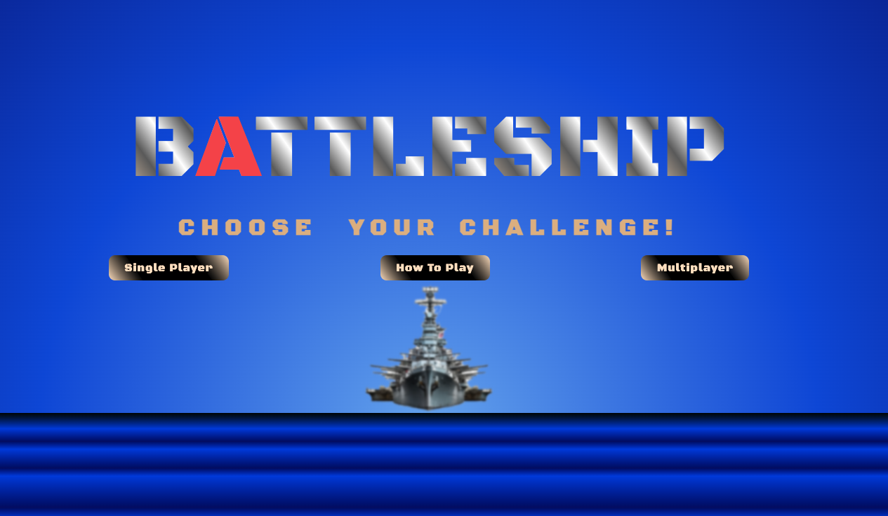
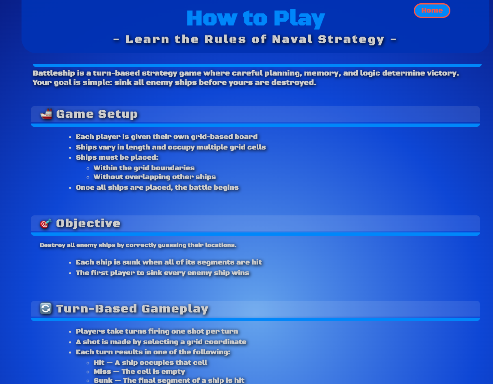
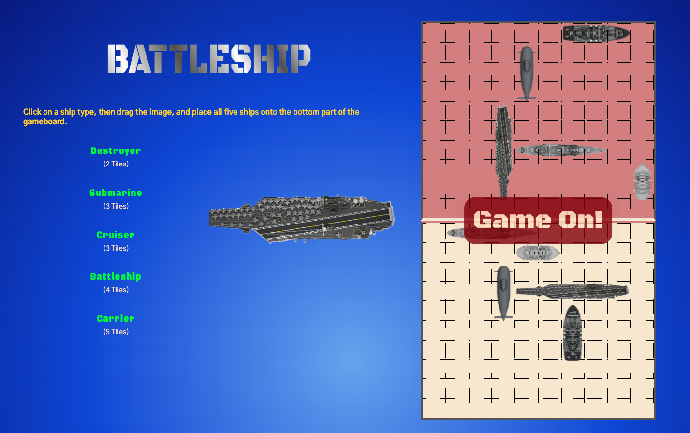
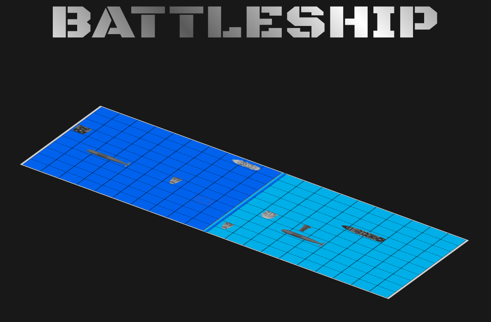

# 🚢 Battleship — A Turn-Based Naval Strategy Game

**Battleship** is a classic turn-based strategy game reimagined as a modern, browser-based application built with a strong front-end architecture.

The game emphasizes **logical deduction, memory, and strategic decision-making**, challenging players to outthink their opponent by systematically locating and destroying enemy ships.

Designed and engineered as a **state-driven React application**, Battleship showcases structured game logic, predictable state transitions, and clean UI separation.

---

## 🧠 Game Overview

Battleship is played on a grid-based board where ships of varying lengths are hidden from the opponent.

### 🎯 Objective
Sink **all enemy ships** before your own fleet is destroyed.

- Each ship occupies multiple grid cells
- Ships are sunk only when all segments are hit
- The first player to eliminate the opposing fleet wins

---

## 🚢 Game Setup

- Players begin by placing ships on their personal grid
- Ships must:
  - Stay within grid boundaries
  - Not overlap other ships
- Ship orientation can be horizontal or vertical
- Once setup is complete, the battle begins

---

## 🔄 Turn-Based Gameplay

- Players take turns firing **one shot per turn**
- A shot is made by selecting a grid coordinate
- Each action results in:
  - **Hit** — A ship occupies the cell
  - **Miss** — Empty water
  - **Sunk** — Final segment of a ship is destroyed
- Turns alternate automatically after each valid shot

This structure rewards **pattern recognition and disciplined targeting**.

---

## ✨ Core Gameplay Features

- 🧭 Grid-based targeting system
- 🚢 Multiple ship types with varying lengths
- 🎯 Hit, miss, and sunk state tracking
- 🔄 Strict turn-based flow enforcement
- 🧠 Logic-driven opponent tracking
- 🔁 Fully replayable matches

---

## ⚙️ Architecture & State Management

- Centralized game state using **React hooks**
- Strongly-typed entities for:
  - Boards
  - Ships
  - Cells
  - Game phases
- Clean separation between:
  - Game logic
  - UI rendering
  - Player interaction
- Predictable state transitions for:
  - Setup
  - Active play
  - Game end

The architecture is intentionally built to be **maintainable, readable, and extensible**.

---

## 🛠️ Tech Stack

### Core Technologies
- **React** — Component-driven UI
- **TypeScript** — Strong typing for game logic and state
- **JavaScript (ES6+)** — Core logic utilities
- **HTML5** — Semantic markup
- **CSS3** — Layout, transitions, and visual feedback

### Front-End Patterns
- Functional components
- Controlled state updates
- Conditional rendering for game phases
- Modular UI components

---

## 📸 Game Screenshots

- **Main Page** — Entry point and game introduction  

- **How-To Page** — Rules, mechanics, and strategy overview  

- **Setup Page** — Ship placement phase  

- **Board Game Page** — Active gameplay and turn-based combat  

---

## 🎯 Project Goals & Developer Focus

This project was built to:

- Demonstrate **structured front-end game logic**
- Apply **TypeScript to non-trivial state modeling**
